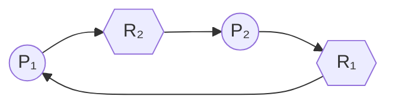

# 死锁 (Deadlock)

## 定义

**死锁**是指两个或多个[[进程]]在相互等待对方释放资源，导致所有相关进程都无法继续执行的状态。每个进程持有一些资源，同时等待其他进程持有的资源，形成循环等待。

---

## 死锁产生的四个必要条件

> 四个条件**必须同时成立**才会发生死锁。

| 条件                        | 说明                                                                        |
| ------------------------- | ------------------------------------------------------------------------- |
| **互斥 (Mutual Exclusion)** | 资源一次只能被一个进程使用                                                             |
| **持有并等待 (Hold and Wait)** | 进程已持有至少一个资源，同时在等待获取其他进程持有的资源                                              |
| **不可剥夺 (No Preemption)**  | 资源不能被强制从进程中剥夺，只能由持有者主动释放                                                  |
| **循环等待 (Circular Wait)**  | 存在一组进程 {P₁, P₂, ..., Pₙ}，P₁ 等待 P₂ 持有的资源，P₂ 等待 P₃ 持有的资源，...，Pₙ 等待 P₁ 持有的资源 |

---

## 死锁的处理策略

### 1. 死锁预防 (Deadlock Prevention)
> 破坏四个必要条件中的至少一个，确保死锁不会发生。

| 条件 | 预防方法 | 代价 |
|------|---------|------|
| 互斥 | 使用共享资源（如只读文件）代替互斥资源 | 不适用于所有资源 |
| 持有并等待 | 进程在开始前一次性申请所有资源 | 资源利用率低，可能导致饥饿 |
| 不可剥夺 | 进程申请新资源失败时释放已持有资源 | 实现复杂，可能丢失工作进度 |
| 循环等待 | 对资源编号，进程按顺序申请 | 影响编程灵活性 |

### 2. 死锁避免 (Deadlock Avoidance)
> 在资源分配过程中动态判断是否会导致死锁，只分配安全的资源。

#### 安全状态
存在一个**安全序列**，使得系统按该序列分配资源时所有进程都能顺利完成。

#### [[银行家算法]] (Banker's Algorithm)
- 由 Dijkstra 提出
- 每次分配前检查系统是否处于**安全状态**
- 核心数据结构：

| 数据结构 | 含义 |
|---------|------|
| `Available[m]` | 每种资源的可用实例数 |
| `Max[n][m]` | 每个进程对每种资源的最大需求 |
| `Allocation[n][m]` | 当前已分配给每个进程的资源数 |
| `Need[n][m]` | 每个进程还需要的资源数（= Max - Allocation） |

> **算法步骤**：当进程请求资源时，先假装分配 → 检查是否进入安全状态 → 是则分配，否则等待。

### 3. 死锁检测 (Deadlock Detection)
> 允许死锁发生，但提供检测机制。

#### 资源分配图 (Resource Allocation Graph)
- **圆圈** → 进程
- **方框** → 资源类型（圆点表示实例）
- **申请边** → 进程 → 资源（进程请求资源）
- **分配边** → 资源 → 进程（资源已分配给进程）

> **检测条件**：如果资源分配图中存在**环**，且每个资源类型只有一个实例，则一定发生了死锁。多个实例时，环是必要条件但不充分。

#### 检测算法
- 寻找一个可以满足其需求的进程
- 分配资源给它，完成后回收资源
- 重复直到没有进程可以推进
- 剩余无法推进的进程即为死锁进程

### 4. 死锁恢复 (Deadlock Recovery)

| 方法 | 做法 | 问题 |
|-----|------|------|
| **终止进程** | 终止全部死锁进程或逐个终止 | 可能丢失大量计算 |
| **资源抢占** | 从某些进程剥夺资源给其他进程 | 回滚开销大，可能导致饥饿 |
| **进程回滚** | 将进程回滚到安全检查点 | 需要系统支持检查点机制 |

---

## 资源分配图实例

> 上图中：P₁ 持有 R₁ 并等待 R₂，P₂ 持有 R₂ 并等待 R₁ → **循环等待**，发生死锁。

---

## 饥饿 (Starvation) vs 死锁

| | 饥饿 | 死锁 |
|--|------|------|
| **定义** | 进程长时间无法获得所需资源 | 进程相互等待，都无法推进 |
| **是否阻塞** | 进程可以继续执行其他代码 | 进程完全阻塞 |
| **解除方式** | 等待资源释放后自动解除 | 必须外部干预 |
| **资源原因** | 资源分配策略不公平 | 循环等待资源 |

---

## 常见面试题

1. **死锁与活锁的区别？**  
   → 活锁中进程在不断改变状态尝试获取资源但未阻塞；死锁中进程完全阻塞。

2. **哲学家就餐问题的解决方式？**  
   → 限制同时拿起叉子的哲学家数量、使用信号量、引入服务员（管程）等。

3. **数据库中的死锁如何处理？**  
   → 使用超时机制、死锁检测 + 回滚牺牲事务、按固定顺序加锁。

---

## 相关笔记

- [[操作系统/进程管理|进程管理]]
- [[操作系统/进程调度|进程调度]]

## 参考资料

- 《操作系统概念》（Silberschatz, Galvin, Gagne）
- 《现代操作系统》（Tanenbaum）
- 银行家算法动画演示：https://www.cs.huji.ac.il/~feit/poold/opt/bank.html
